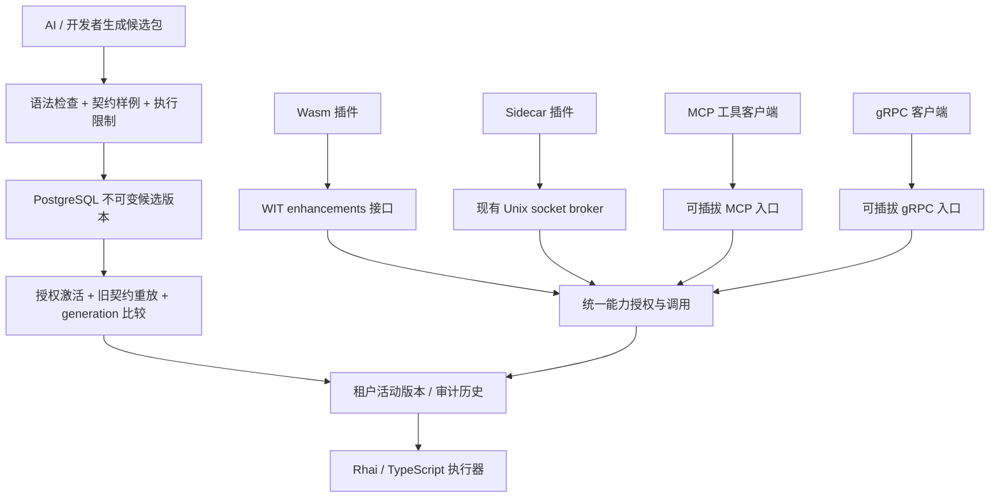

# 微内核、脚本自举与能力演进

## 当前判断

持续演进的完整范围与未完成项见 [一切皆插件验收清单](everything-as-plugin.md)；不能以某个阶段的局部测试代替整体验收。

AIO 已具备动态业务包、Wasm 和受控 process 执行、能力授权、整包健康检查、版本恢复与回滚，但不能称为“一切皆插件”。`aio-idea` 仍静态装配身份、权限、字典等系统插件。`az-plugin-core` 已支持不携带数据库/HTTP 的最小装配模式，宿主服务、路由、基础设施初始化与关闭已由插件组合选择；精简 HTTP 宿主不连接数据库、不加载密钥或执行引擎。整包执行器与脚本执行器已可替换，组件内部仍固定使用 PostgreSQL 和对象存储。平台无业务依赖，并不等于所有平台策略都可动态替换。

本次补充的是可编程的运行时能力层：AI 或开发者可以生成 Rhai/TypeScript 候选包，通过验证、发布和回滚在运行期间增强已有宿主。新旧插件只要声明了对应能力路径，就可使用当前租户已激活的实现，无需把脚本或解释器复制进每个插件。

## 保留最小可信基础

Rust 宿主继续掌握身份校验、权限检查、资源限制、协议入口、持久化提交和版本选择。脚本提供纯计算能力，输入输出为 JSON，不持有文件、网络、数据库、进程或管理员句柄。解释器及其限制也不能被脚本自行改写。

这使“自举”具有具体边界：运行中的系统可以验证和装载新的能力实现，但承载这套验证规则的原生基础仍需要正常的软件发布。宿主二进制的自我更新需要独立监督器、旧版本恢复入口、数据兼容检查和切换验收；本次没有实现或宣称这部分热替换。



## 能力契约与版本

能力路径采用 `/v1/领域/操作`。这是可跨进程的业务协议地址；Rust 进程内插件身份仍用具体类型的 TypeId，不能把路径当成第二套 DI 注册表。

一个增强包包含多个路径、源码语言和输入输出样例，整个包按 SHA256 摘要发布并整体切换。普通升级必须保留旧路径、旧样例并重放通过，避免删掉验收用例后悄悄改变结果。有限样例不能证明所有输入的兼容性；语义破坏仍应新增 `/v2/...`。TypeScript 做语法解析和转译，类型注解不等于运行时输入验证。

```toml
[plugin.capabilities]
enhancements = ["/v1/math/add", "/v1/text/slug"]
```

Wasm 通过 `aio:plugin/enhancements@2.0.0` 的 `invoke(path, input_json)` 调用。新增独立接口，既有导入接口保持原样；历史 Component 仍可运行。新导入需要已经包含此实现的宿主版本，不能将源码提交视为已升级所有部署。

Sidecar 通过已有 broker socket 向 `POST /enhancements/invoke` 发送：

```json
{ "path": "/v1/math/add", "input": { "left": 2, "right": 3 } }
```

继续携带现有 `x-aio-token`。broker 校验活动插件版本，由已安装包提供能力清单，并注入租户和来源身份；请求没有可伪造的 tenant/source 字段。两种入口都返回 `{ "revision": "摘要", "output": 5 }`。代码缓存不保存调用状态，运行时升级不会自动给旧插件追加未申请的权限。

## Rhai 与 TypeScript

语言实现通过 Dill 注入的 `ScriptExecutor` 编译成 `ScriptProgram`，包验证与调用分发不再包含语言实现分支。默认实现由 `RhaiPlugin`、`TypeScriptPlugin` 选择；`ScriptRuntimePlugin` 不依赖数据库或组件存储。`EnhancementServicePlugin` 单独持有持久化与版本服务，MCP/gRPC 无需初始化整个组件执行环境。原生执行器替换仍通过受控宿主装配完成，不由候选脚本自行注册。

- Rhai 使用嵌入式引擎，关闭模块和动态 eval，限制操作数、调用深度、表达式深度、变量、函数及容器大小。
- TypeScript 使用 Oxc 的 AST 转译，然后在 QuickJS 的独立上下文执行；不安装模块加载器、Node、文件或网络 API，拒绝外部模块声明和 Promise 返回值。
- 每次调用建立独立作用域，输入输出限制 64 KiB；脚本源码最多 32 KiB，整个包最多 256 KiB；QuickJS 限制 16 MiB 堆和 256 KiB 栈，执行有 100 ms 中断检查，Rhai 另有 100,000 操作上限。
- 两种语言通过 `call_enhancement(path, input)` 组合包内增强，清单 `calls` 声明直接依赖，调用者须拥有全部传递依赖权限。整条链固定版本与身份，共享 100 ms 时限、64 次调用、8 层深度与 1 MiB 累计 JSON 额度；取消沿调用链传播，异常捕获不能重置预算。可执行示例为 `lib/plugin/enhancement/examples/composition.json`。
- 执行限制用于约束运行时行为，不等价于操作系统进程隔离；Rhai 没有与 QuickJS 相同的独立堆限额，解释器也属于可信基础。面对不可信第三方脚本或需要硬资源隔离时，应把执行器放进现有 sidecar 监督边界。

可以先在本地验证示例包，再交给已授权的宿主发布 API：

```sh
cargo run -p az-plugin-enhancement --example verify -- \
  lib/plugin/enhancement/examples/dual-language.json
```

管理员 API 与事务行为见 [宿主增强入口](../../lib/plugin/host/src/runtime/server/enhancements/README.md)。AI 生成候选与激活候选是两个独立操作。当前未绑定具体 AI 模型、未添加自动批准器，也没有让脚本直接调用发布接口。

## Sidecar、MCP 与 gRPC

| 机制 | 应承担的职责 | 本次状态 |
| --- | --- | --- |
| Sidecar | 原生依赖、长任务、进程隔离和独立重启 | 复用现有 process supervisor/broker，已接入同一增强服务 |
| WIT | Wasm 与宿主之间的类型边界 | 已增加通用增强调用接口 |
| MCP | 给 AI 提供工具发现和执行 | 官方 SDK 的 Streamable HTTP 已接入增强；当前 schema 是通用 JSON input，不提供自动发布 |
| gRPC | 有类型的跨进程/跨机器通信 | Tonic 与生成的 Protobuf 契约已接入增强发现/执行、消息限额和截止时间；当前为 unary |

MCP 和 gRPC 适配器消费同一份增强目录、请求响应与版本服务，不保存另一套活动指针，也不允许调用方自报租户。MCP 的工具发现不是授权；gRPC 的类型正确不代表权限正确。Sidecar 是执行边界，可以承载 MCP 或 gRPC 服务，但宿主仍决定哪些能力能被调用。接入方式、权限和真实客户端验收见 [协议入口](../../lib/plugin/host/src/runtime/server/protocols/README.md)。将任意外部 MCP/gRPC 服务导入为能力提供者仍未实现。

## 下一层改进的验收门槛

1. 将身份、策略、存储、调度、可观测性等平台服务逐个拆成可替换提供者；保留独立救援入口，避免身份插件失败后无法管理系统。
2. 同包增强组合已有依赖声明、授权衰减、共享预算、截止时间、取消及循环拒绝；进一步接入宿主和远端能力时，还需定义异步副作用、幂等键及失败补偿。
3. 对多节点演进增加分批放量、真实健康指标、自动回退政策和运行时版本兼容矩阵。当前数据库指针保证版本一致，不能代替整个集群的滚动升级。
4. 自动回退前验证数据迁移兼容性。代码回滚不能被描述为业务数据回滚。
5. 故障演练覆盖宿主崩溃、监督器重启、数据库断连及执行器耗尽资源。正常样例和单次发布成功不能证明架构完美。
